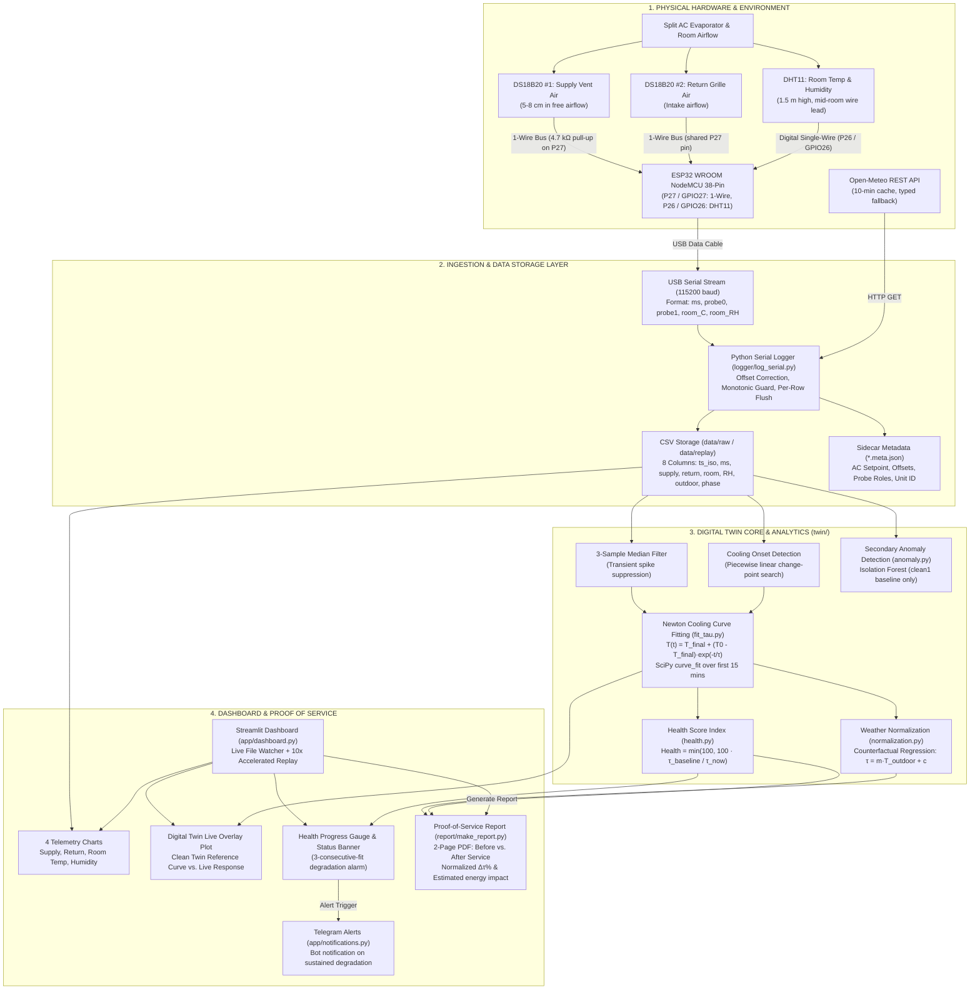

# ClimaTwin: System Architecture Diagram (Task 101)

**Team TRIANGLE** | CIT Make-A-Thon (Track 2: Digital Twin)  
**Authors**: Nithish P (Lead Architect), Nikil S (Software Lead), Harish S (Hardware Lead)  
**Document Version**: 2.0 (Prototype Specification)  

---

## 1. End-to-End System Architecture



---

## 2. Hardware Wiring & Pin Mapping Reference

| Component | Interface | ESP32 Pin | Wiring Specifications | Operating Notes |
|---|---|---|---|---|
| **DS18B20 #1 (Supply Probe)** | 1-Wire | `P27` (`GPIO27`) | $4.7\text{ k}\Omega$ pull-up to $3\text{V}3$, GND to GND | Positioned 5–8 cm in discharge airflow; shares `Col 24` bus on breadboard. |
| **DS18B20 #2 (Return Probe)** | 1-Wire | `P27` (`GPIO27`) | Shared 1-Wire bus, same $4.7\text{ k}\Omega$ pull-up | Mounted on intake grille; cold-bottle pinch test confirms probe index. |
| **DHT11 (Room Temp & RH)** | Digital 1-Wire | `DATA: P26` (`GPIO26`) | $3\text{V}3$ VCC, GND to GND (onboard pull-up) | Placed mid-room at 1.5 m height away from direct AC draft and ESP32 heat. |
| **USB Serial Interface** | UART | Micro-USB | Baud rate: $115200$ | Continuous raw 5-column transmission every $\sim 5.8\text{ s}$ (`delay(5000)` + DS18B20 conversion). |

---

## 3. Data Contract Pipeline

```
[ESP32 Firmware]
  │
  ▼ Raw Serial Line (ASCII)
  "ms,probe0_C,probe1_C,room_C,room_RH\r\n"
  │
[logger/log_serial.py]
  ├── Corrects sensor offsets: T_corrected = T_raw + offset
  ├── Assigns probe roles (probe0 = supply/return, probe1 = return/supply)
  ├── Queries Open-Meteo REST API for outdoor temperature (10-minute cache)
  ├── Detects microcontroller reboots / millis wrap (ms < previous_ms)
  └── Immediately flushes row to disk
  │
  ▼ Repository CSV Standard (data/raw/run_<phase>_<timestamp>.csv)
  Columns: [ts_iso, ms, supply_C, return_C, room_C, room_RH, outdoor_C, phase]
  Sidecar: run_<phase>_<timestamp>.meta.json (Setpoint, sensor offsets, fan setting, unit ID)
```

---

## 4. Digital Twin Mathematical Model Summary

1. **Newton Cooling Formulation**:
   $$T_\text{room}(t) = T_\text{final} + (T_0 - T_\text{final}) \cdot e^{-t/\tau}$$
   - $t$: Elapsed time in minutes since detected cooling onset.
   - $T_0$: Fitted room temperature at cooling onset.
   - $T_\text{final}$: Asymptotic steady-state room temperature.
   - $\tau$ (Tau): Thermal pull-down time constant (Minutes). Larger $\tau =$ slower cooling $=$ degraded performance.

2. **Cooling Health Score**:
   $$\text{Health} = \min\left(100.0, \; 100 \times \frac{\tau_\text{baseline}}{\tau_\text{now}}\right)$$
   - $\text{Health} = 100$: Identical or faster cooling compared to healthy baseline.
   - $\text{Health} < 80$: Flags cooling degradation. Alert fires after 3 consecutive 60-second fits below threshold.

3. **Weather-Normalized Service Verification**:
   - Pre-service regression: $\tau_\text{expected} = m \cdot T_\text{outdoor} + c$
   - Performance Improvement:
     $$\Delta \tau_\text{normalized} = \frac{\tau_\text{expected} - \tau_\text{actual}}{\tau_\text{expected}} \times 100\%$$
